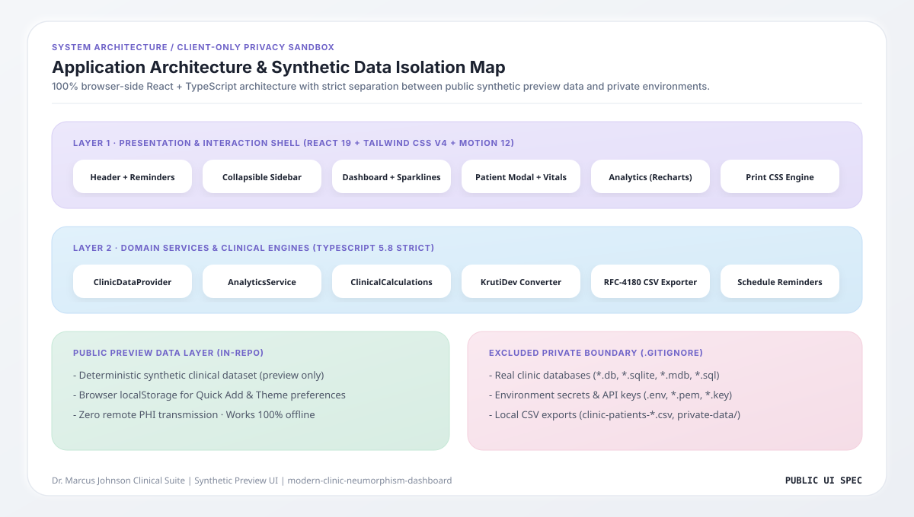
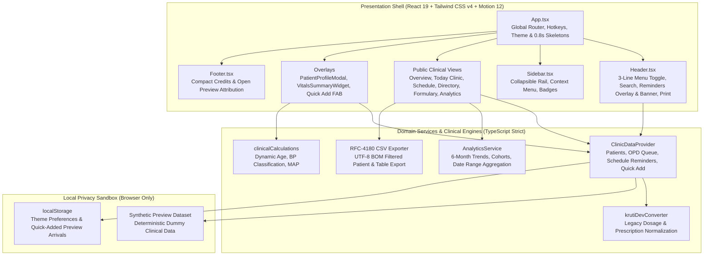
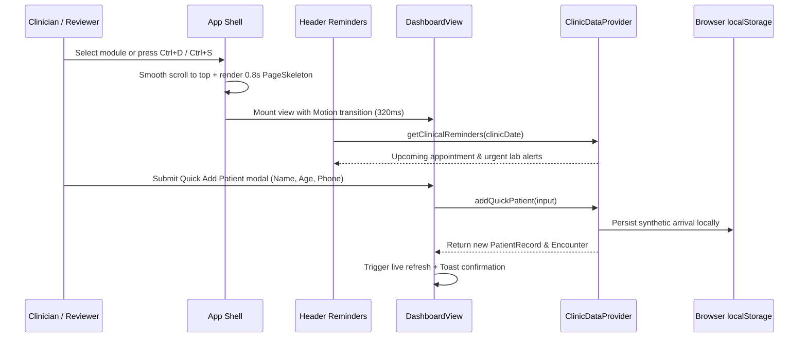

# System Architecture

This document explains the modular client-side architecture, state boundaries, and privacy isolation model of **Modern Clinic Neumorphism Dashboard** (`Dr. Marcus Johnson Clinical Suite`).

---

## Architectural Overview





---

## Directory Structure

```text
modern-clinic-neumorphism-dashboard/
├── index.html                          # Entry HTML, Google Fonts (Outfit, Plus Jakarta Sans, JetBrains Mono)
├── package.json                        # React 19, Vite 6, Tailwind v4, Recharts 3, Motion 12, Lucide
├── tsconfig.json                       # Strict TypeScript 5.8 compiler config
├── vite.config.ts                      # Vite build & Tailwind CSS v4 plugin setup
├── .gitignore                          # Excludes secrets, .env, real DBs (*.sqlite, *.db, *.sql), CSV exports
├── LICENSE                             # MIT License with Attribution & Synthetic Preview Notice
├── README.md                           # Main GitHub documentation & visual showcase
├── docs/
│   ├── ARCHITECTURE.md                 # System architecture & data-flow specification
│   ├── FEATURES_AND_MODULES.md         # Public modules & clinical workflow breakdown
│   ├── DESIGN_SYSTEM.md                # Soft Pastel Neumorphism tokens, 7 themes & typography
│   ├── TECH_STACK_AND_TOOLS.md         # Libraries, build pipeline & engineering rationale
│   ├── USAGE_AND_SHORTCUTS.md          # Quick start, hotkeys, print engine & CSV guide
│   ├── PRIVACY_AND_DATA_POLICY.md      # Synthetic preview guarantee & public usage policy
│   └── screenshots/                    # 17 visual preview assets (5 raster + 12 vector specs)
└── src/
    ├── main.tsx                        # React 19 root mount
    ├── App.tsx                         # Workspace shell, 0.8s page skeletons, keyboard shortcuts
    ├── index.css                       # 7-theme CSS variables, neumorphic shadows, @media print rules
    ├── types/clinic.ts                 # Shared TypeScript interfaces
    ├── data/
    │   ├── forensicDataset.ts          # Deterministic synthetic preview generator (dummy data only)
    │   └── krutiDevConverter.ts        # Prescription text & dosage formatting engine
    ├── services/
    │   ├── dataProvider.ts             # Data access facade, Quick Add persistence, Schedule Reminders
    │   └── analyticsService.ts         # Longitudinal charts, cohorts & date range computations
    ├── utils/
    │   └── clinicalCalculations.ts     # Age computation, MAP & blood pressure classification
    ├── components/
    │   ├── Header.tsx                  # Top bar, 3-line/X toggle, Clinical Reminders Banner & Overlay
    │   ├── Sidebar.tsx                 # Collapsible icon-rail / expanded sidebar + context menu
    │   ├── HorizontalNav.tsx           # Optional horizontal top navigation bar
    │   ├── PatientVitalsChart.tsx      # Recharts multi-series historical BP & weight chart
    │   ├── VitalsSummaryWidget.tsx     # Print-ready tabular BP, MAP & pulse history widget
    │   ├── Modal.tsx                   # Accessible elevated dialog surface
    │   ├── Skeleton.tsx                # Contextual 0.8s shimmer page loaders
    │   ├── Toast.tsx                   # Global toast feedback provider
    │   ├── Tooltip.tsx                 # Lightweight portal hover tooltips
    │   ├── DataTable.tsx               # Sortable, filterable clinical table primitive
    │   ├── DemoGuideModal.tsx          # Interactive walkthrough & shortcut legend
    │   └── Footer.tsx                  # Compact credits, references & attribution footer
    └── views/                          # Public clinical pages (Dashboard, Today, Calendar, Search, etc.)
```

---

## State & Rendering Lifecycle



---

## Key Architectural Decisions

1. **Zero Backend Dependency for Public Preview**: Every view, filter, sparkline, chart, and CSV export runs deterministically in the browser so anyone cloning the repository can evaluate the full interface immediately without configuring API keys or database credentials.
2. **Strict Data Provider Facade**: All UI views consume `ClinicDataProvider` and `AnalyticsService` instead of reading raw storage directly, allowing clean replacement with a private REST, GraphQL, or PostgreSQL/MySQL API in private deployments.
3. **Dedicated Print Media Pipeline**: Interactive chrome (`Sidebar`, `Footer`, `FAB`, `Header` reminder banner) carries `.no-print`, while clinical tables (`.vitals-summary-print`, `.print-vitals-table`) switch cleanly to high-contrast black-on-white tabular layouts during `window.print()`.
