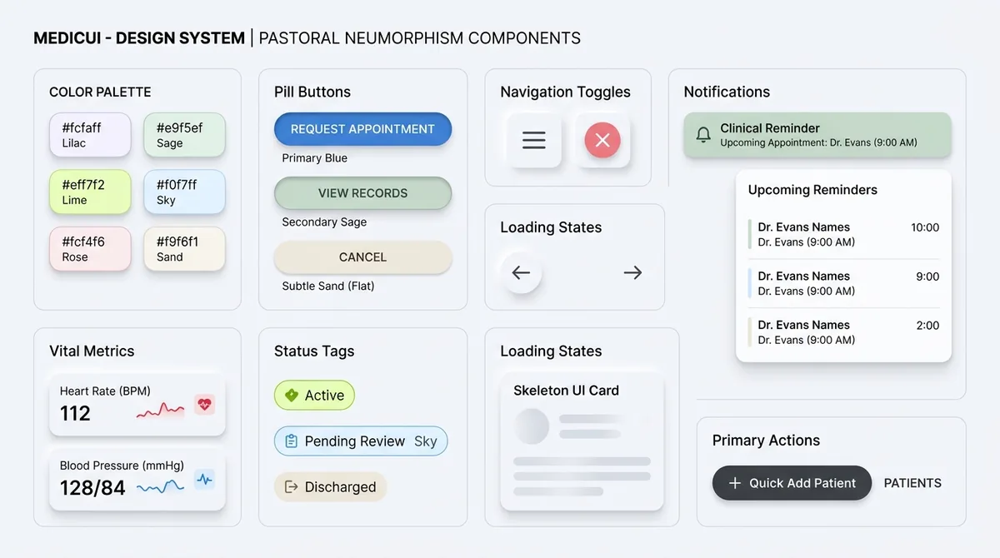
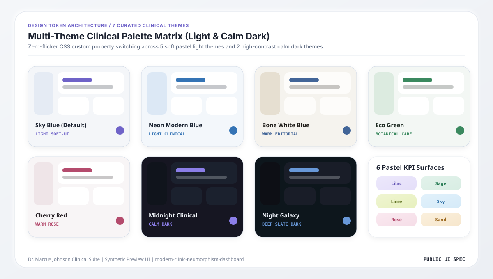

# Design System & Soft Pastel Neumorphism Specification

The visual language of **Modern Clinic Neumorphism Dashboard** combines whisper-soft neumorphic tactile depth with calm pastel clinical surfaces, generous corner radii, and strict typographic hierarchy.

---

## Component Pattern Sheet

---

## 7-Theme Clinical Token Matrix

| Theme Identifier | Mode | Primary Canvas | Elevated Card | Primary Accent | Intended Context |
|---|---|---|---|---|---|
| `sky-blue` (Default) | Light | `#f4f6f9` | `#ffffff` | `#6f63c8` | Daily high-clarity outpatient workflow |
| `neon-modern-blue` | Light | `#f3f7fb` | `#ffffff` | `#3574b5` | Crisp hospital & diagnostic blue |
| `bone-white-blue` | Light | `#f5f3ee` | `#fdfcfa` | `#426598` | Warm editorial low-glare reading |
| `eco-green` | Light | `#f3f7f4` | `#ffffff` | `#3b895f` | Calm botanical wellness palette |
| `cherry-red` | Light | `#f8f5f6` | `#ffffff` | `#b44b6d` | Warm rose clinical contrast |
| `midnight-clinical` | Dark | `#131720` | `#1b212e` | `#8b7ee8` | Low-light evening rounds (zero glare) |
| `night-galaxy` | Dark | `#11131a` | `#191d28` | `#6898d8` | Deep slate analytics & charting |

---

## Surface, Curve & Elevation Rules

- **Canvas-to-Sidebar Distinction**: The vertical navigation rail uses a cool slate-mist gradient (`--sidebar-bg`) separated from the alabaster workspace canvas (`--bg-primary`) by a crisp hairline (`--sidebar-border`).
- **Generous Curves**: Primary cards use `rounded-[24px]`, inner interactive rows use `rounded-[16px]` to `rounded-[18px]`, and buttons, search bars, and badges use full pill geometry (`rounded-full`).
- **Whisper-Soft Neumorphism**: Shadows rely on low-opacity cool navy ambient occlusion (`rgba(32, 42, 64, 0.055)`) paired with a subtle top-left specular highlight (`rgba(255, 255, 255, 0.85)`), avoiding heavy muddy drop shadows.

---

## Typography System

| Role | Font Family | Usage |
|---|---|---|
| Display & Headings | `Outfit` | Page titles, KPI figures, brand wordmark (`johnson.`) |
| UI Body & Controls | `Plus Jakarta Sans` | Labels, clinical notes, buttons, navigation items |
| Clinical Numerics | `JetBrains Mono` | Serial numbers (`#52530`), BP/HR vitals, dates, fees (`tabular-nums`) |

---

## Navigation & Micro-Interaction Patterns

- **3-Line Menu to Red-Pink Close (`X`)**: In the Header, the sidebar toggle renders a clean 3-line hamburger icon by default and transitions to a red-pink circular `X` (`#e11d48`) when the sidebar is expanded. Inside the expanded sidebar, the collapse control displays a calm side-menu collapse icon at rest and shifts to the red-pink `X` on hover/focus.
- **0.8-Second Contextual Page Skeletons**: Every module switch triggers a smooth scroll-to-top and a tailored shimmer skeleton (`PageSkeleton`) before animating the view in via `motion/react` (`ease: [0.22, 1, 0.36, 1]`).
- **Icon Discipline**: 100% crisp vector Lucide icons — zero raw emojis anywhere in UI chrome, tables, or documentation.
