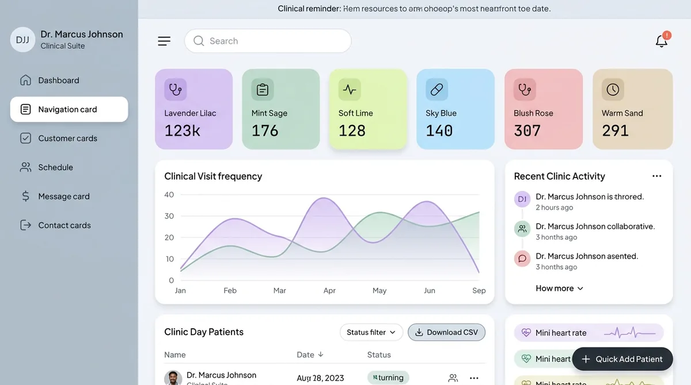
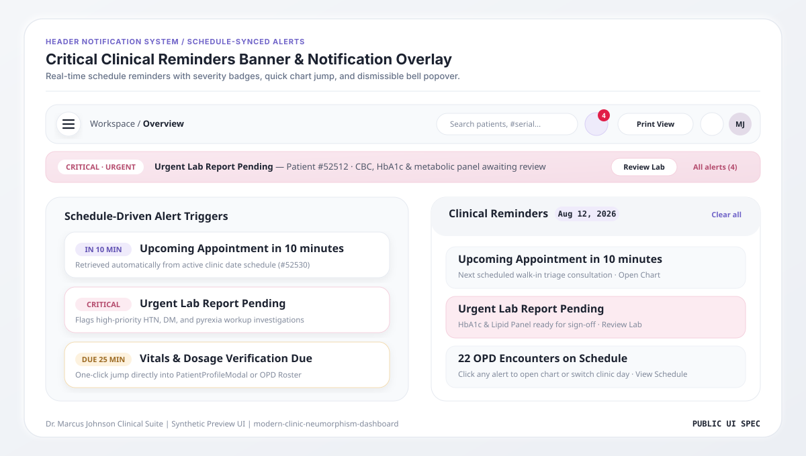
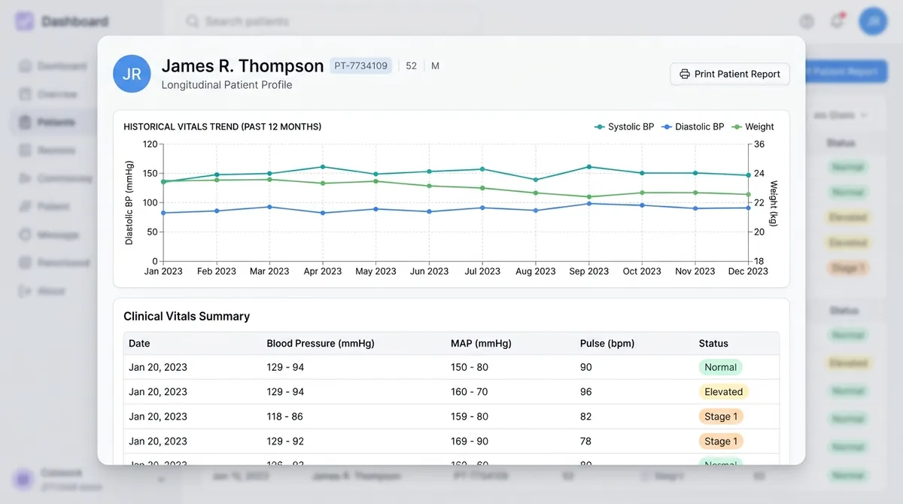
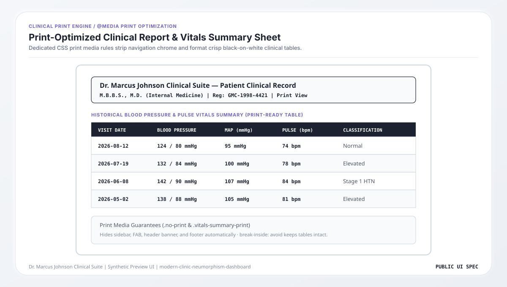
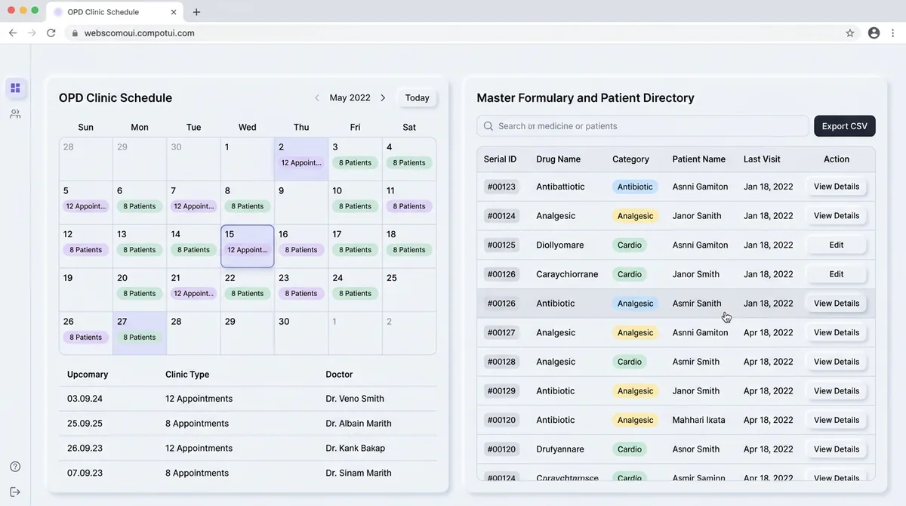
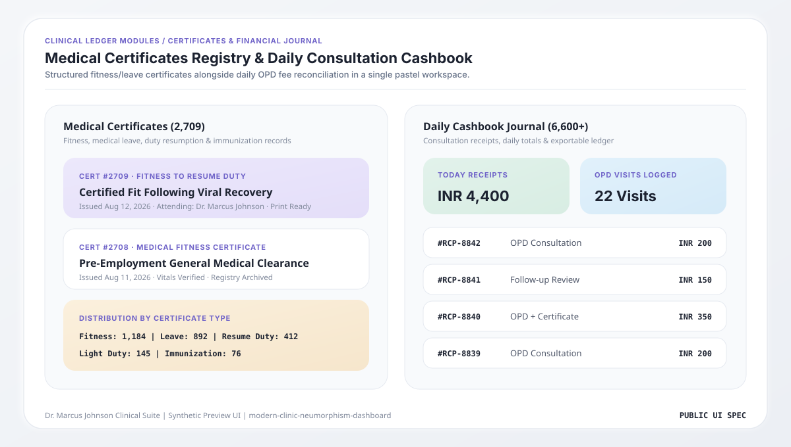
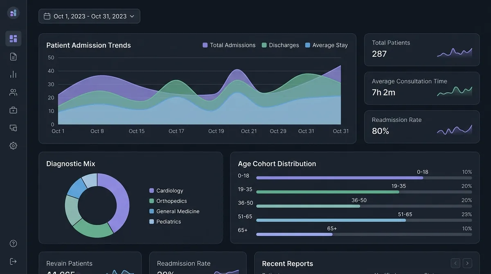

# Public Modules & Clinical Features

Every public-facing screen in **Modern Clinic Neumorphism Dashboard** is built for calm visual hierarchy, laptop ergonomics, and immediate clinical legibility. Internal administrative or private backend operations are intentionally excluded from the public repository.

---

## 1. Clinical Overview Dashboard

- **6 Pastel Hero KPI Cards**: Total Patients, Historical Encounters, Clinic Day OPD, Master Medicines, Rx Shortcuts, and Issued Certificates — each styled with whisper-soft neumorphic elevation and one-click drill-down.
- **Daily Clinical Snapshot & Care Continuity**: Live OPD completion ring (`conic-gradient`) paired with returning-patient retention progress bar and mean cohort statistics.
- **6-Month Patient Visit Frequency Chart**: Interactive Recharts line visualization with series switching (`Total Visits`, `Follow-ups`, `New Patients`) and month-over-month delta badge.
- **Recent Clinic Activity Feed**: Chronological card feed filterable by `All`, `Tasks`, and `Records` with direct navigation to patient profiles, certificates, and daily ledgers.

---

## 2. Critical Clinical Reminders (Header Banner & Bell Overlay)

- **Schedule-Synced Intelligence**: `ClinicDataProvider.getClinicalReminders(clinicDate)` derives alerts directly from the active clinic date's roster (such as `Upcoming Appointment in 10 minutes` and `Urgent Lab Report Pending`).
- **Slim Dismissible Top Banner**: Displays the active priority alert beneath the header with prev/next cycling, direct action button (`Open Chart` / `Review Lab` / `View Schedule`), and quick dismiss control.
- **Interactive Bell Overlay Popover**: Animated dropdown displaying unread count badge, severity tags (`Critical`, `Urgent`, `Schedule`), individual dismissal, `Clear all`, and one-click `Restore` capability.

---

## 3. Clinic Day Patients, Mini Sparklines & Filtered CSV Export

- **Patient Status Filter Dropdown**: Filter consultations by `All Statuses`, `Active`, `Pending Review`, or `Discharged` with live counts per category.
- **Inline Mini Recharts Sparklines**: Every patient row includes a compact Recharts trend curve toggleable between **Heart Rate (HR bpm)** and **Blood Pressure (BP mmHg)** with hover tooltips and automatic elevated-reading highlighting.
- **One-Click Filtered CSV Download**: Exports the exact filtered patient list (`clinic-patients-YYYY-MM-DD-status.csv`) using RFC-4180 escaping and a UTF-8 BOM header for clean Excel and Google Sheets compatibility.

---

## 4. Quick Add Patient FAB & Rapid Onboarding

- **Floating Action Button**: Always-accessible bottom-right pill CTA on the Overview Dashboard (`no-print`) with smooth Motion hover/tap physics.
- **Minimal Required Fields**: Validates `Patient Full Name`, `Age (1–120)`, and `Phone Number`, with optional `Sex` and `Chief Complaint` fields.
- **Instant Live Persistence**: Automatically assigns the next serial number, creates a baseline OPD triage encounter, saves to local preview storage, updates KPI counters, and displays a toast notification.

---

## 5. Longitudinal Patient Profile & Print-Ready Vitals Summary

- **Historical Vitals Line Chart**: Recharts multi-axis visualization plotting longitudinal Systolic BP, Diastolic BP, and Weight trajectories.
- **Print-Optimized Vitals Summary Table**: Formatted clinical table displaying Visit Date, Blood Pressure (`mmHg`), calculated Mean Arterial Pressure (`MAP`), Pulse (`bpm`), clinical classification (`Normal`, `Elevated`, `Stage 1 HTN`, `Stage 2 HTN`), and encounter context.
- **Print Patient Report**: Triggers native browser printing styled by dedicated `@media print` rules.

---

## 6. Daily OPD Clinic, Schedule Calendar & Master Formulary

| Module | Key Capabilities | Visual Preview |
|---|---|---|
| **Today's Clinic OPD** | Date-selectable outpatient queue, vitals triage strip, and formatted prescription preview |  |
| **Patients Directory** | Multi-field ranked search across 43,488+ synthetic profiles with sort controls & pagination |  |
| **Rx Shortcuts (357)** | Rapid clinical shorthand templates organized by therapeutic specialty |  |
| **Certificates & Cashbook** | Medical fitness/leave certificates ledger & daily consultation receipts reconciliation |  |

---

## 7. Clinical Analytics & Calendar Date-Range Reports

- **Interactive Date-Range Picker**: Filter historical analytics between specific calendar dates with quick preset pills and custom start/end selectors.
- **26+ Analytical Views & Charts**: Multi-year visit volume, seasonal morbidity patterns, diagnostic mix donut breakdown, and gender-filtered age cohorts.
- **Calm Dark Mode Clarity**: High-contrast slate charcoal surfaces with muted lavender, sage, and sky data strokes — zero neon glare or hidden text.
